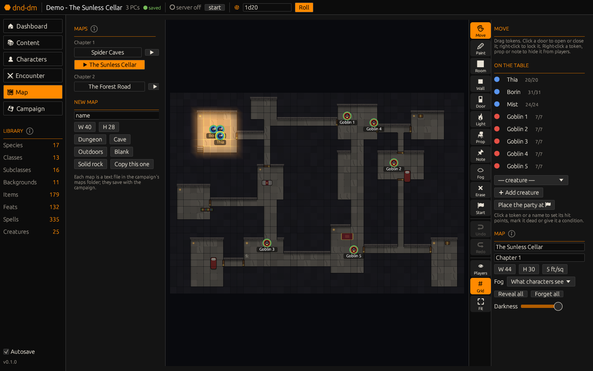
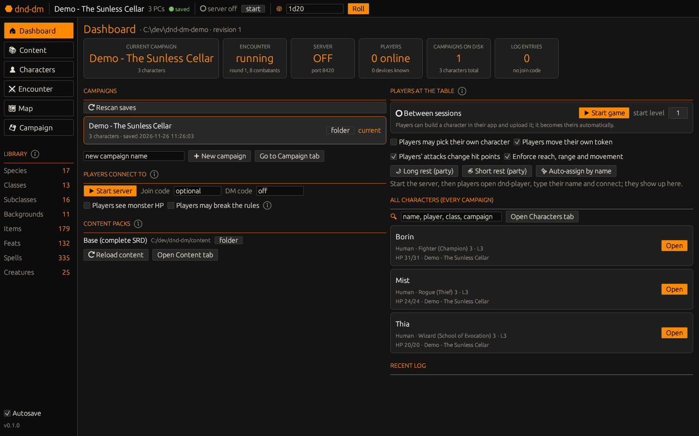
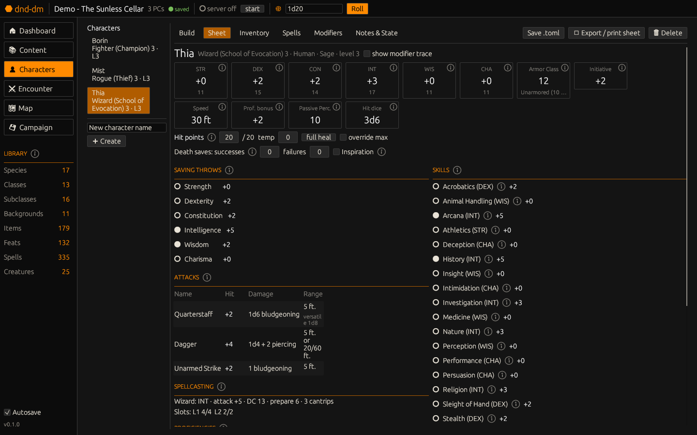
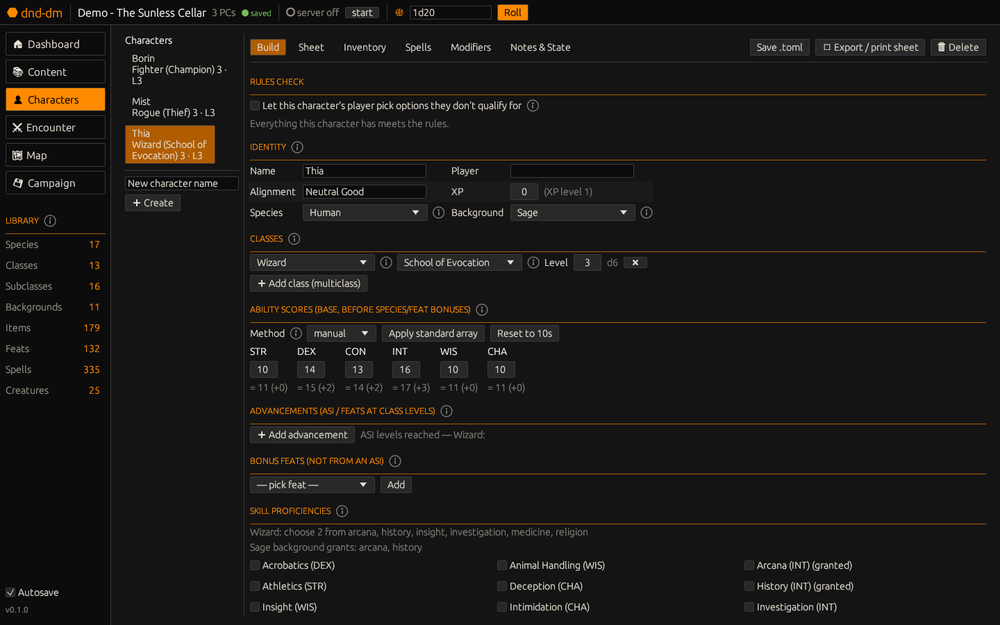
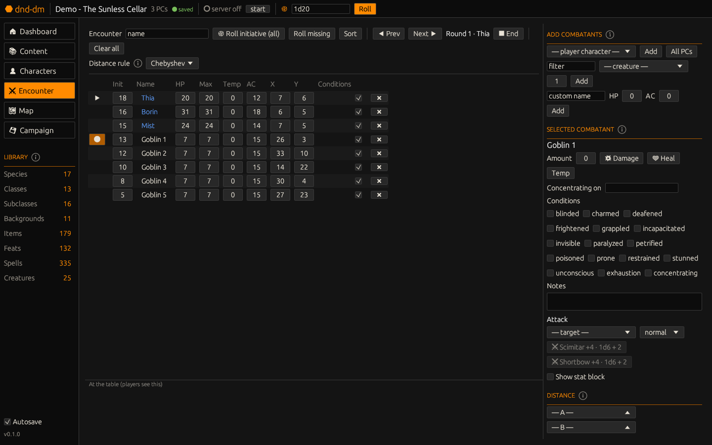
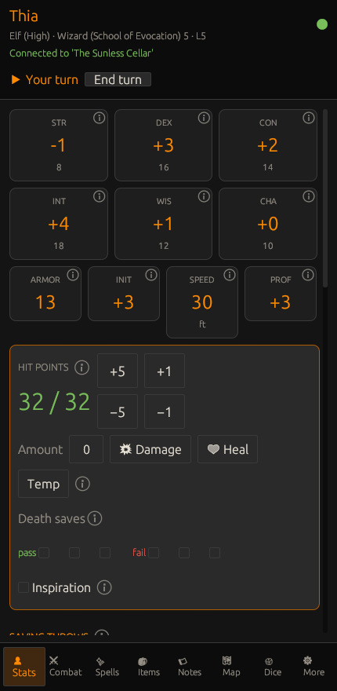
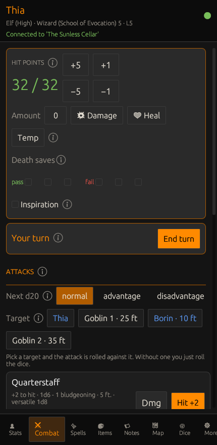
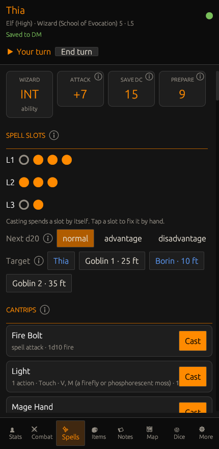
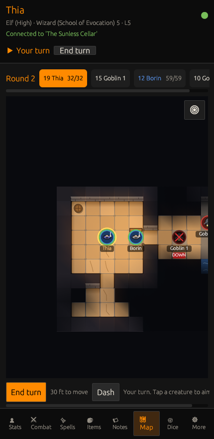
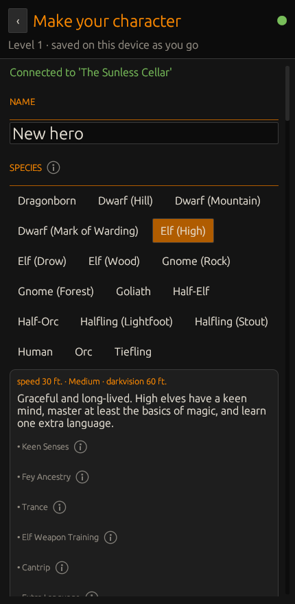

<h1 align="center">dnd-dm</h1>

<p align="center">
  <b>A Dungeon Master's toolkit for D&amp;D 5e and homebrew, written in Rust.</b><br>
  Run the game from your PC. Your players follow along on their phones.
</p>

<p align="center">
  
  
  
  
</p>

<p align="center">
  
</p>

<p align="center">
  <a href="#what-you-get">What you get</a> ·
  <a href="#screenshots">Screenshots</a> ·
  <a href="#features">Features</a> ·
  <a href="#get-started">Get started</a> ·
  <a href="#writing-content">Writing content</a> ·
  <a href="#docs">Docs</a>
</p>

## What you get

**The DM app** (Windows or Linux) is your screen behind the screen. It holds
the rules, the content library, every character and the live game, and it
runs a small server on your Wi-Fi.

**The player app** (Android, or a desktop window) finds the DM on the network
and gives each player their live character sheet, dice, spells and their own
view of the map. Every roll is made on the DM's PC, so nobody fudges.

**Everything is plain text.** Species, classes, spells, creatures, characters
and whole campaigns are readable TOML files you can edit, share and keep in
git. The complete SRD ships in the box.

## Screenshots

### The DM app

<p align="center">
  <br>
  <sub><b>Dashboard</b>: campaigns, server, content packs, who's at the table and every character in one place.</sub>
</p>

<table>
  <tr>
    <td width="50%"></td>
    <td width="50%"></td>
  </tr>
  <tr>
    <td><sub><b>Character sheet</b>: every number is worked out from the build, and every (i) explains a term in plain words.</sub></td>
    <td><sub><b>Build</b>: pick species, class, subclass and background from forms. The rules check flags anything the character doesn't qualify for.</sub></td>
  </tr>
  <tr>
    <td colspan="2"></td>
  </tr>
  <tr>
    <td colspan="2"><sub><b>Encounter</b>: initiative, hit points, conditions, attacks against a target and areas of effect, with turns announced to the whole table.</sub></td>
  </tr>
</table>

### The player app

<table>
  <tr>
    <td></td>
    <td></td>
    <td></td>
    <td></td>
    <td></td>
  </tr>
  <tr>
    <td><sub><b>Sheet</b></sub></td>
    <td><sub><b>Combat</b></sub></td>
    <td><sub><b>Spells</b></sub></td>
    <td><sub><b>Map</b>: you only see what your character sees</sub></td>
    <td><sub><b>Make a character</b> between sessions</sub></td>
  </tr>
</table>

## Features

**Rules that do the maths**
- Ability modifiers, proficiency, saves, skills, expertise, AC (armor, shields,
  Unarmored-Defense-style formulas), hit points, hit dice, initiative, speed,
  attacks, spell attack, save DC and slots (single class and multiclass),
  passive scores and carrying capacity.
- Every number carries a trace of which source changed it and why.
- Formulas everywhere: `"2 * level"`, `"max(1, wis_mod + class.cleric.level)"`,
  `"1d8 + str_mod"`, conditions like `"armored && level >= 5"`.
- **Rules checks**: a subclass taken too early, an invocation without its
  pact, a spell above the castable level, armor the character can't wear
  well. The DM may give a character anything (it shows with a red outline and
  the reason); players can only pick what their character qualifies for,
  unless the DM allows rule breaks for everyone or for one character.

**Fights and maps**
- Initiative tracker, hit points, conditions, attacks and spells rolled
  against a target (AC, saves, resistances, upcasting, healing).
- Reach, range, line of sight and movement are enforced from the sheet.
- Distance by 5e, 5-10-5 or Euclidean rules; "who is within 20 ft"; spheres,
  cubes, cones and lines highlighted on the battle map.
- Maps with walls, doors, lights, props and notes; fog of war and line of
  sight per character; dungeon, cave and outdoor generators; several maps per
  campaign. See [docs/MAPS.md](docs/MAPS.md).
- **Death is final**: three failed death saves and the character is dead
  until revivify, raise dead, resurrection or the DM brings them back.

**At the table**
- Wi-Fi server with a JSON API and WebSocket push. Phones find the DM by
  scanning the network.
- Players register by name and the DM hands out characters, or lets them pick.
- Player-safe views: hidden loot and DM notes never leave the DM app.
- Players build their own characters between sessions, with spells, class
  choices and starting gear, and send them in.
- Rolls from any phone show up for everyone in the table feed.

**Content you own**
- `content/` ships the whole SRD: all 12 classes (levels 1 to 20) plus the
  Artificer, each with its subclass and every class choice (fighting styles,
  invocations, metamagic, infusions and more), 17 races and subraces, 335
  spells with class lists, the full weapon and armor tables, adventuring gear,
  packs, poisons and 11 backgrounds with suggested personality traits,
  ideals, bonds and flaws.
- Form-based editing on the Content tab: the app writes the TOML for you.
  Base content is never touched; edits become overrides in `homebrew/`.
- Later packs override earlier ones by id, so homebrew can replace anything.

**Friendly to new players**
- A small (i) next to every game term, stat, skill, condition, class, spell
  and item explains it in plain language: hover on a PC, tap on a phone.

**Saving and printing**
- The campaign (characters, encounter, maps, log) autosaves to
  `saves/<campaign>/` about a second after every change and reopens on start.
- One click exports an HTML character sheet or stat block to print or save
  as PDF.

## Get started

### Windows

You need [Rust](https://rustup.rs) 1.80 or newer and the Microsoft C++ Build
Tools ("Desktop development with C++"), which Rust uses to build on Windows.

```powershell
git clone https://github.com/Openanonwriter/dnd-dm.git
cd dnd-dm
cargo run --release -p dnd-dm
```

On first start the app creates `homebrew/`, `saves/`, `exports/` and a
`dnd-dm.toml` config next to `content/`.

- **Windows Firewall** asks about dnd-dm the first time the server starts.
  Allow it on private networks so phones can connect.
- **"Access is denied"** while building means the app is still open. Close it
  (it saves on exit) and build again.

### Try the demo campaign

Writes *Demo - The Sunless Cellar* (a party of three, five goblins, a dungeon
in play and two more maps on the shelf) into `saves/`:

```powershell
cargo run --release -p dnd-core --example demo_campaign -- content saves
```

To try the player app on its own, `cargo run --release -p dnd-player --example demo`
opens it against a little game running inside the same program.

### Player app

- **Desktop** (a phone-sized window, handy for testing): `cargo run --release -p dnd-player`
- **Android**: `.\build-android.ps1` builds `dist\dnd-player.apk`. It needs
  the Android SDK and NDK, JDK 17, Gradle 8 and `cargo-ndk`; see
  [docs/PLAYER_APP.md](docs/PLAYER_APP.md).

### Linux

`./build-linux.sh --deps --desktop --firewall` builds both apps on x86_64 or
ARM64 and puts them in `dist/dnd-dm-linux-<arch>/`. See
[docs/LINUX.md](docs/LINUX.md).

### Tests

```powershell
cargo test --workspace
```

Covers the rules engine, grid maths, save and load, the server, and a check
that every file in `content/` parses and is explained.

## Writing content

Copy a file from `content/<kind>/` into `homebrew/<kind>/`, change the `id`,
edit the rest, and press **Reload content** in the app. Or create it from the
Content tab. The full format is in [docs/CONTENT_FORMAT.md](docs/CONTENT_FORMAT.md).

A modifier is the one mechanism that changes numbers:

```toml
[[modifiers]]
target = "ac"            # what to change
op = "add"               # add | set | max | min | mul | grant | expertise | advantage | disadvantage | note
value = "1"              # a formula
condition = "armored"    # optional formula; applies only when true
```

## Folder layout

```
content/            base pack (complete SRD): species/ classes/ items/ ... rules.toml
homebrew/           your pack; same layout; overrides content/ by id
saves/<campaign>/   campaign.toml + characters/*.toml + maps/*.toml
exports/            printable HTML sheets and TOML character exports
crates/dnd-core     rules engine, data model, TOML loader, grid, export
crates/dnd-server   axum HTTP + WebSocket LAN server
crates/dnd-dm       egui desktop app (the DM)
crates/dnd-mapview  map renderer and help icons shared by both apps
crates/dnd-player   egui player app: Android (NativeActivity) + desktop
build-android.ps1   cargo-ndk + Gradle -> dist/dnd-player.apk
build-linux.sh      Linux build of both apps
```

## Docs

| Doc | What's in it |
| --- | --- |
| [PLAYING.md](docs/PLAYING.md) | Running a session: fights, spells, rests, death, levelling |
| [PLAYER_APP.md](docs/PLAYER_APP.md) | The phone app: build, screens, how it is put together |
| [MAPS.md](docs/MAPS.md) | Maps, fog of war, lighting, walking and doors |
| [CONTENT_FORMAT.md](docs/CONTENT_FORMAT.md) | How to write every kind of content file, all modifier targets |
| [API.md](docs/API.md) | What player apps can call |
| [DEVELOPING.md](docs/DEVELOPING.md) | Dev switches, screenshots, tests, where things live |
| [LINUX.md](docs/LINUX.md) | Building on Linux |
| [MAP_RESEARCH.md](docs/MAP_RESEARCH.md) | The research the map design came from |

## Contributing

Work on a branch and open a pull request. Before you do,
`cargo build --release --workspace` and `cargo test --workspace` must both
pass. Code is Rust only. Content in `content/` must come from the SRD,
written in our own words; original homebrew is welcome in `homebrew/`.
[docs/DEVELOPING.md](docs/DEVELOPING.md) has the build switches and where
things live.

## License

MIT. The content in `content/` includes game mechanics from the System
Reference Document 5.1 ("SRD 5.1") and 5.2 ("SRD 5.2") by Wizards of the
Coast LLC, available at https://www.dndbeyond.com/srd, licensed under the
Creative Commons Attribution 4.0 International License
(https://creativecommons.org/licenses/by/4.0/legalcode). Descriptions are
written in our own words. Material outside the SRD (the books' other
subclasses, races and spells) is not included; add it in `homebrew/`.
